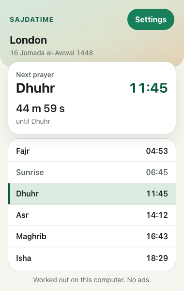
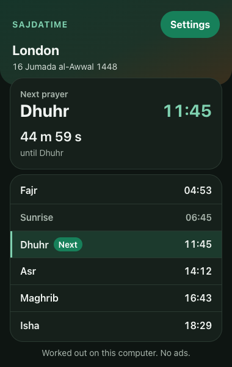
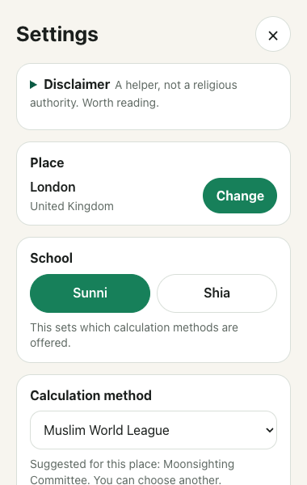
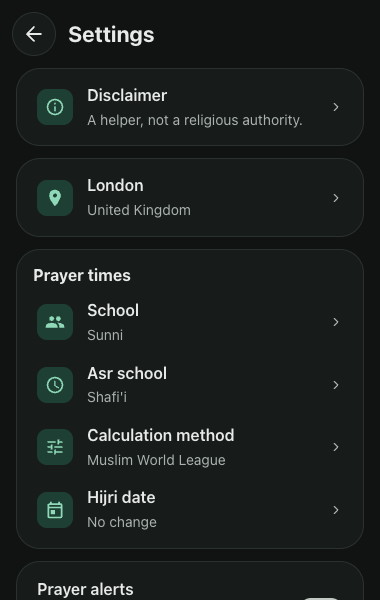
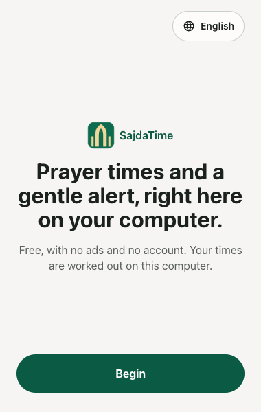
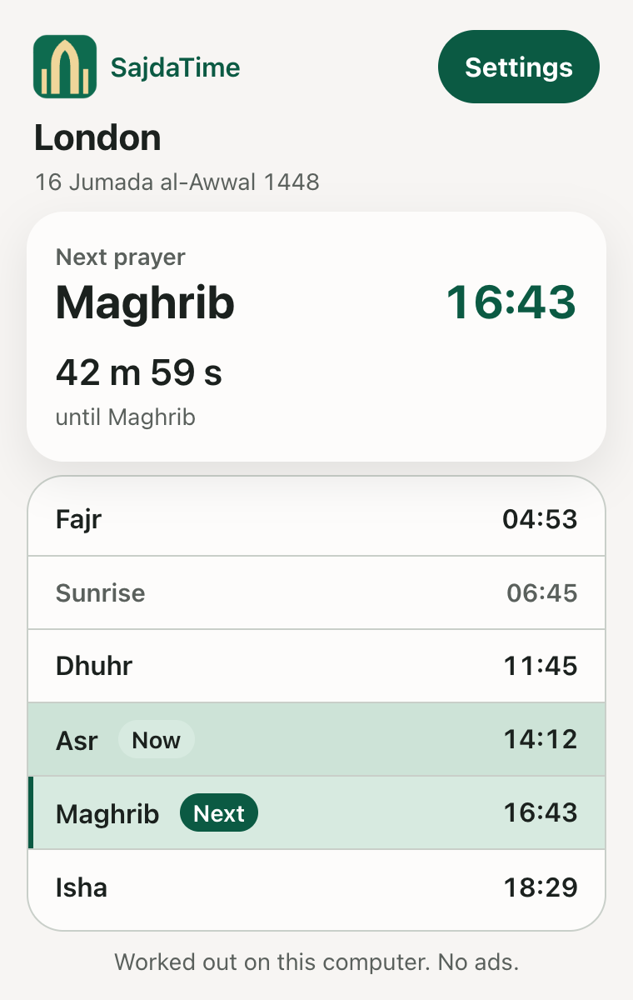
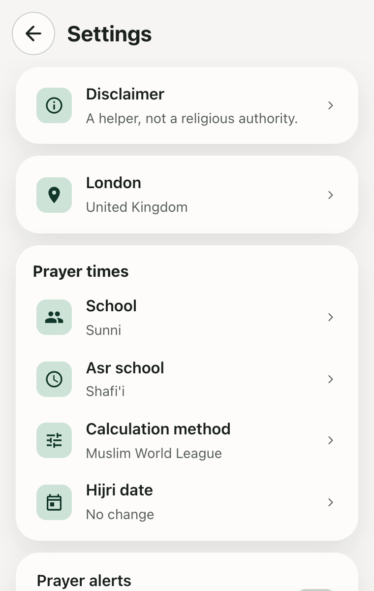

# Review request

**Baseline:** [`aliimrankhan86/sajdatime-extension`](https://github.com/aliimrankhan86/sajdatime-extension) at commit `5c29e83` on `main`. This commit re-fixes the real popup width and measures the real popup.
**Previous reviews:** `fab4abb`; then `eeac1ad`, which fixed the three P1s from the first pass; then `cb92544`, which did the P2s; then `ebcc4e0`, which applied Ali's ruling on the open P1; then the true-angle build and its third-pass fixes; then `f964ee8`, which reversed the true-angle ruling and was judged READY with two P2 fixes to the notes; then `515731e`, which applied those two note fixes; then `7de9d3f`, which added the School choice and the first popup width fix and was judged NOT READY with one P1: the real popup now opened 25 pixels wide. This commit fixes that P1. The School choice is unchanged and accepted; do not reopen it.
**Date:** 27 October 2026.
**Reviewer:** Claude, Opus review pass.
**Owner:** Ali. He presses Submit, Publish, Merge, payment and consent. Do not ask him for credentials.

## What this is

A Manifest V3 browser extension, Chrome first and Edge later. It shows today's six prayer times for a saved place, the next prayer with a countdown, the Hijri date, and a small Settings screen. It is a separate product from the Android app. Do not review it as a port of `SajdaTime` and do not copy phone release notes or store copy into it.

There is no account, no ad, no analytics, no host permission, no content script and no runtime network request. Location is handled on the computer. The full intent is in [`docs/PLAN.md`](PLAN.md). Binding decisions are in [`docs/DECISIONS.md`](DECISIONS.md). If the plan and a decision disagree, the decision wins. The current state is [`docs/HANDOVER.md`](HANDOVER.md).

## What this fix commit changed

The previous commit (`7de9d3f`) set the body to `width: 380px` with `max-width: 100vw`. That collapsed the real action popup to 25 pixels, because Chrome sizes an action popup while its viewport is still tiny, so `100vw` shrank the body to match. The earlier `width: 100%` body collapsed it to 147 pixels. The School choice from that commit is unchanged and accepted; this commit only re-fixes the popup width and the zoom tests.

- **Popup width.** The `html` width rule is gone and the body is a fixed 380 pixels with no `max-width`, the only value that holds in a real popup.
- **Real popup measurement.** `tests/e2e/popup-width.test.ts` now opens the real toolbar popup in headful Chrome for Testing over a remote debugging port and reads the window, body width and Settings button from the DevTools protocol. It fails at 147 pixels against the `width: 100%` body and at 25 pixels against the `max-width: 100vw` body, so it cannot pass for the wrong reason.
- **Zoom tests.** The two zoom tests used to fake zoom by shrinking the viewport to 253 and 190 pixels. Chrome does not shrink a popup viewport on zoom. They now set `deviceScaleFactor: 2` on a 380 by 600 viewport and check that nothing clips, the countdown stays on one line and every control keeps a 44 CSS pixel target.
- **Docs.** `DECISIONS.md` D-013 is corrected to the fixed 380 pixel width and the real-zoom testing. `HANDOVER.md` records the lesson that `100vw` collapses a popup and only a real-popup measurement catches it.

## Why the width bug got through

Every end-to-end test except the new one opens the popup as a 380 by 600 tab, so a real Chrome action popup sizing itself to the document's intrinsic width was never exercised. The first fix added `max-width: 100vw` and a fit-content regression test; that test passed for the wrong reason, because in a 380 pixel tab `100vw` is still 380 pixels. Only a real popup reveals that Chrome measures `100vw` while the popup is still tiny. `tests/e2e/popup-width.test.ts` now opens the real popup headful over a remote debugging port, and it fails against both earlier CSS states.

## What to run

Node 24 and npm 11 were used. Chrome for Testing is needed because branded Chrome refuses an unpacked extension in this setup.

```bash
git clone https://github.com/aliimrankhan86/sajdatime-extension.git
cd sajdatime-extension
npm ci
npm run check
npm run test:e2e
```

`npm run check` runs strict TypeScript, Vitest and a production build. `npm run test:e2e` builds `dist` and drives the loaded extension with Playwright. It finds Chrome for Testing through `SAJATIME_CHROME` or Playwright's cache. If neither exists, set `SAJATIME_CHROME` to a Chrome for Testing binary.

To look by hand, open `chrome://extensions`, enable Developer mode, choose **Load unpacked** and pick `dist/`. The popup is 380 by 600. Settings is the green button in the header.

## What to judge

1. **The popup width fix and its test.** Read `src/popup/styles.css` and confirm the `html` width rule and the body `max-width` are gone, leaving a fixed 380 pixel body with no maximum. Check that `tests/e2e/popup-width.test.ts` opens the real toolbar popup over the DevTools protocol, not a tab, and that its four assertions could not pass for the wrong reason. Check the two zoom tests set `deviceScaleFactor: 2` and assert no clipping, a single-line countdown and 44 pixel controls. The School choice from the earlier commit is accepted; do not reopen it.
2. **Design against the brief.** Quiet Glass tokens, 380 by 600 popup, spacing, type hierarchy, the solid green action button with bold white text, no two icon buttons side by side, a close control on every dismissable screen, times in tabular numerals, nothing below 14 pixels, targets at least 44 pixels. The plan's section 3 and section 6 are the written brief.
3. **The Times screen in every state.** First open, next prayer today, next prayer tomorrow after Isha, a current prayer that is not the next one, sunrise as a quieter row, a polar estimate, a very long place name, 12-hour and 24-hour browser languages, 200 percent zoom, light and dark.
4. **First run and Settings.** Whether the words are plain and true, whether the location flow is understandable without a manual, whether Settings preserves a deliberately chosen method when the place changes, and whether the disclaimer is intact and readable. The disclaimer must never be removed, softened or hidden.
5. **Accessibility.** axe is not a screen reader. Check the tab order, the heading focus, Escape, the `aria-current` value, the live city hint and whether the visible pills match what is announced. Check the new `aria-disabled` controls still behave for keyboard and pointer, and that focus does not move during a save.
6. **Correctness and privacy in the code.** The engine mirrors the phone's high-latitude rule, the projection to the signed reference latitude, the Ramadan Isha adjustment, manual corrections last and the ascending clamp. The manifest should still ask only for `storage` and `geolocation`. There should be no `fetch` to a remote host, no remote code and no content script.
7. **Test quality.** Look for tests that only assert the code's own output, tests that pass for the wrong reason, and state that is not covered. The engine fixtures are the phone's values, not Aladhan's, except the broad sanity fixtures. The high-latitude Shia values were produced with the phone's Java adhan library, not by running the extension.
8. **Documentation accuracy.** If a claim in `HANDOVER.md` is not true of this commit, that is a finding.

## Evidence in this commit

`npm run check`: 8 unit files, 89 tests passed, strict typecheck passed, production build passed.
`npm run test:e2e`: 30 tests passed.

| Test file | What it covers |
| --- | --- |
| `tests/unit/engine.test.ts` | Phone fixtures, including the five high-latitude Shia cases, polar projection and correction clamp |
| `tests/unit/aladhan.test.ts` | 13 broad independent sanity fixtures |
| `tests/unit/methods.test.ts` | The Sunni and Shia method split and the offered list |
| `tests/e2e/popup.test.ts` | Times, 200 percent zoom, countdown tick, 12-hour language, tomorrow Fajr, first run wording, Makkah fallback, Settings, city search, method persistence |
| `tests/e2e/audit.test.ts` | Asr school, method change, place change, dark link contrast, keyboard focus and Escape, focus after a save |
| `tests/e2e/design.test.ts` | Now and Next pills, Next row has no `aria-current`, 44 pixel controls, 200 percent zoom, dark flat card, no network request |
| `tests/e2e/a11y.test.ts` | axe 4.14, WCAG 2.2 AA tags, Times, Settings, Location and first run, light and dark |
| `tests/e2e/school.test.ts` | School set, both reset directions, the keep case, focus after a save |
| `tests/e2e/popup-width.test.ts` | The real action popup opens at 380 by 600 with the Settings button visible |
| `tests/unit/contrast.test.ts` | 14 token pairs, including the hero gradient stops and the focus ring |

## Screenshots

These are review evidence at 380 by 600, not the final store set.









The 200 percent zoom Settings screenshot is deliberately tall. It shows the stacked school and Hijri controls, and the native select truncating the longest method name. Judge whether that is acceptable at that zoom, not as the normal layout.

## Known gaps, do not report as new

- The Times header is the scaffold version: a word mark and a Settings pill, not the plan's 32 pixel logo, Gregorian date over the Hijri date, and town chip with pin and refresh. The footer is one line, not the two solid buttons. The next card has no glyph and no five prayer bars.
- The next card uses a 28 pixel name and time with a 22 pixel countdown. The plan's type table says a 46 pixel countdown. The previous review accepted the compact card; Ali also accepted it. Do not reopen it unless it causes a real usability fault.
- The full first run is not built. There is one location step and a city search. The school, madhab, language and six-step sequence are later milestones. The first-run pick always starts Sunni and suggests a method from the country.
- No alarms, badge, notifications, offscreen audio, Ramadan notices, suhoor, Eid, PDF timetable, Qibla or full About page.
- English only. No language switcher and no right-to-left layout yet. A remaining recorded P2: an Arabic browser shows Arabic meridian words beside the English labels. The digits are not yet forced to Latin.
- City search matches Latin names only.
- A remaining recorded P2: after midnight the Isha row still shows tonight's time with a "Now" pill.
- A remaining recorded P2: the default method survives a place change if the user never chose one.
- A remaining recorded P2: the polar note does not name the latitude it borrowed.
- No Edge run, no Windows run and no real screen reader run. These are stated limits.
- `tests/e2e/popup-width.test.ts` runs headful, because `chrome.action.openPopup()` never surfaces a measurable target under headless Chrome. On a machine without a display, only that test cannot run; the other 29 run headless.
- No GitHub Actions workflow. This Mac's `gh` login lacks the `workflow` scope. Local checks are the evidence.
- The real browser geolocation bubble is mocked in the tests because the extension origin cannot be granted a permission from Playwright.
- The store listing, privacy URL and zip are not final.
- The service worker is nearly empty by design. Its presence is not evidence that alarms work.

## Verdict wanted

Give a verdict in this shape:

- **P0** permanent breakage or a privacy or permission breach.
- **P1** silent wrong result, unusable state, or religious or location content that misleads.
- **P2** quality, maintainability, test gap or design polish.

For each finding: file and line, what happens, how you reproduced it, what the user sees, and the smallest fix. If a finding is based only on reading, say so. If you reran a test, paste the command and result. Do not call the work done because the suite is green. The point of this pass is to find what the green suite missed.

State clearly whether the previous P1s are actually fixed, and whether this commit is ready for Ali to look at. If another review round is needed, say what the next smallest set of changes is.
