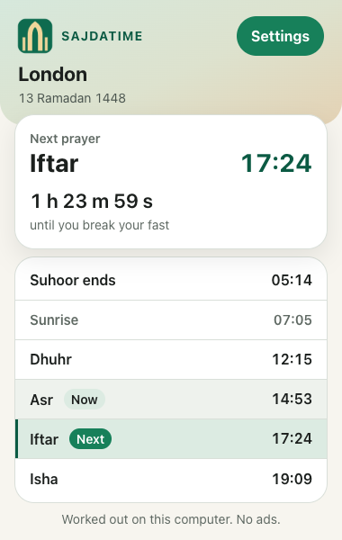
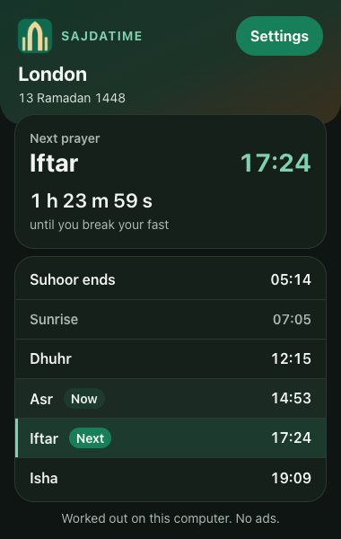
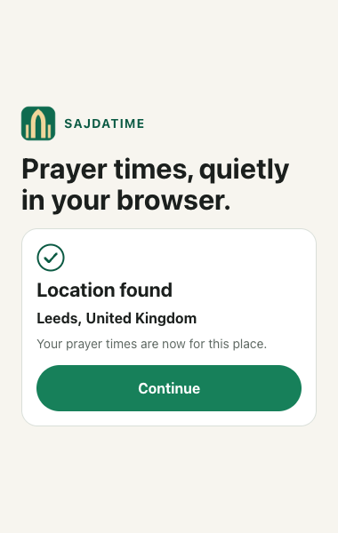
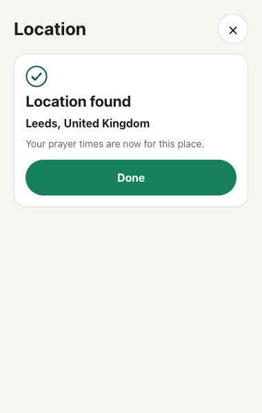

# Review request

**Baseline:** [`aliimrankhan86/sajdatime-extension`](https://github.com/aliimrankhan86/sajdatime-extension) at commit `a534306` on `main`, plus this Step 3a commit on top of it, which is the one to review. `a534306` is the accepted Step 2 P3 fix. Step 3a of [`docs/BUILD-NEXT.md`](BUILD-NEXT.md) adds Ramadan labels: inside Ramadan the Times screen reads Fajr as "Suhoor ends" and Maghrib as "Iftar", the hero and countdown follow, the Hijri date already names the day, and a "Ramadan" group in Settings holds one switch that turns the card off.

**Previous reviews:** Step 1 (`ca39f1a`), on top of the security foundation commit, was judged READY with three P2 fixes applied; do not reopen the School choice, the popup width fix or the Shia Maghrib rule. Step 2 (`cf60111`) was reviewed and judged NOT READY: a notification icon URL resolved against the worker script so no alert ever appeared (P0), the Play button never returned to Play after the beep ended (P1), and a settings rebuild cleared the 60 second self-clear alarm so a pinned notification never went away (P2). The fix commit `fd002ba` repaired all three and added the tests that should have caught them, and Step 2 was then judged READY. A P3 fix (`a534306`) made a replaced sound never report its end, so starting a new sound over a playing one no longer flips Play back to Play. The security foundation is `docs/SECURITY.md` enforced by code. All of these are history for this review.

**Date:** 28 October 2026.
**Reviewer:** Claude, Opus review pass.
**Owner:** Ali. He presses Submit, Publish, Merge, payment and consent. Do not ask him for credentials.

## What this is

A Manifest V3 browser extension, Chrome first and Edge later. It shows today's six prayer times for a saved place, the next prayer with a countdown, the Hijri date, a small Settings screen, optional prayer alerts, and Ramadan labels for Suhoor and Iftar. It is a separate product from the Android app. Do not review it as a port of `SajdaTime` and do not copy phone release notes or store copy into it.

There is no account, no ad, no analytics, no host permission, no content script and no runtime network request. Location is handled on the computer. The full intent is in [`docs/PLAN.md`](PLAN.md). Binding decisions are in [`docs/DECISIONS.md`](DECISIONS.md). If the plan and a decision disagree, the decision wins. The current state is [`docs/HANDOVER.md`](HANDOVER.md).

## What this commit changed

This is Step 3a of [`docs/BUILD-NEXT.md`](BUILD-NEXT.md): Ramadan labels, shown automatically every year.

- **A `ramadanCard` setting, on by default.** `Settings` gains `ramadanCard: boolean`, written `true` for a new install and added by the migration for an existing one. `isSettings` rejects anything that is not a boolean, and the migration preserves a value the user has already chosen. This step adds no new permission.
- **Inside Ramadan, Fajr and Maghrib are renamed.** While today is inside Ramadan on Umm al-Qura (with the user's Hijri shift) and the card is on, the hero names the next prayer "Suhoor ends" or "Iftar", the countdown note reads "until suhoor ends" or "until you break your fast", the Fajr row reads "Suhoor ends" and the Maghrib row "Iftar". Every other prayer keeps its name, and turning the card off returns all six to normal. `src/core/hijri.ts` already held the Ramadan windows; this step only renders them.
- **Settings gains a Ramadan group.** Above Alerts and shown while the card would ever apply (inside Ramadan or up to three days before), one "Ramadan card" switch with no hint text. The Isha-plus-thirty-minutes rule for Umm al-Qura in Ramadan was already in the engine and is untouched.
- **No network, still.** The popup and Settings read only the stored settings and the bundled Hijri table. The R6 no-network test is unchanged and still passes.

## What to run

Node 24 and npm 11 were used. Chrome for Testing is needed because branded Chrome refuses an unpacked extension in this setup.

```bash
git clone https://github.com/aliimrankhan86/sajdatime-extension.git
cd sajdatime-extension
npm ci
npm run check
npm run test:e2e
```

`npm run check` runs strict TypeScript, Vitest, a production build and then `tools/check-bundle.mjs`, the `docs/SECURITY.md` bundle scan. `npm run test:e2e` builds `dist` and drives the loaded extension with Playwright. It finds Chrome for Testing through `SAJATIME_CHROME` or Playwright's cache. If neither exists, set `SAJATIME_CHROME` to a Chrome for Testing binary.

To look by hand, open `chrome://extensions`, enable Developer mode, choose **Load unpacked** and pick `dist/`. The popup is 380 by 600. Settings is the green button in the header, and the Ramadan group is between Hijri and Alerts while it applies.

## What to judge

1. **The Ramadan window.** Read `src/core/hijri.ts` and confirm `ramadanInfo` and `contains` draw from Umm al-Qura with the user's shift, and that the Times screen applies the labels only inside Ramadan while Settings shows the group for the wider window. The location step, the School choice, the popup width fix, the Shia Maghrib rule and the Step 2 alerts are accepted; do not reopen them.
2. **Design against the brief.** Quiet Glass tokens, 380 by 600 popup, spacing, type hierarchy, the solid green action button with bold white text, no two icon buttons side by side, a close control on every dismissable screen, times in tabular numerals, nothing below 14 pixels, targets at least 44 pixels. The new "Ramadan card" switch must meet the same bar in light and dark.
3. **The Times screen in Ramadan.** Fajr and Maghrib renamed before and after Isha (the hero says "Iftar" before Maghrib and "Suhoor ends" after Isha), every other row unchanged, the whole view still inside 600 pixels without a scrollbar, and a normal view outside Ramadan.
4. **The setting.** The "Ramadan" group appears only while the card would apply, the switch is on by default, turning it off returns the labels to normal and the choice survives a reload, and the disclaimer is intact.
5. **Accessibility.** axe is not a screen reader. Check the tab order, the heading focus, Escape, the `aria-current` value, the switch `role="switch"` and `aria-checked`, and that the hero's `aria-label` matches the renamed prayer.
6. **Correctness and privacy in the code.** The engine mirrors the phone's high-latitude rule, the projection, the Ramadan Isha adjustment, manual corrections last and the ascending clamp. The manifest should ask only for `alarms`, `notifications`, `storage`, `offscreen` and `geolocation`; this step adds none. No `fetch` to a remote host, no remote code, no content script, and `tools/check-bundle.mjs` still fails the build on any.
7. **Test quality.** Look for tests that only assert the code's own output, tests that pass for the wrong reason, and state that is not covered. The Ramadan dates are pinned to Umm al-Qura fixtures.
8. **Documentation accuracy.** If a claim in `HANDOVER.md` is not true of this commit, that is a finding. The permissions in `docs/privacy.html` are unchanged.

## Evidence in this commit

`npm run check`: 12 unit files, 144 tests passed, strict typecheck passed, production build passed, then the bundle scan passed.
`npm run test:e2e`: 52 tests passed.

| Test file | What it covers |
| --- | --- |
| `tests/unit/engine.test.ts` | Phone fixtures, including the five high-latitude Shia cases, polar projection and correction clamp |
| `tests/unit/aladhan.test.ts` | 13 broad independent sanity fixtures |
| `tests/unit/hijri.test.ts` | Umm al-Qura Ramadan windows pinned: 1 Ramadan 1447 and 1448, the 29 day length, day numbers and Eids |
| `tests/unit/methods.test.ts` | The Sunni and Shia method split and the offered list |
| `tests/unit/settings.test.ts` | Validators: unknown method, coordinates outside the world, unknown time zone, a place name over 200 characters, a damaged or missing `alerts` object, and a non boolean `ramadanCard`; the migration adds the default card and keeps a chosen `false` |
| `tests/unit/manifest.test.ts` | The manifest lock: exact keys, exact five permissions, the content security policy, no route from a web page |
| `tests/unit/alerts.test.ts` | `scheduledAlarms` names and ordering, the refresh alarm, empty when off, Shia Maghrib, `isLate` at four and six minutes, `parseAlarmName` |
| `tests/unit/messages.test.ts` | `parseAlertMessage` accepts the extension page and rejects a wrong id, a web URL, a lookalike URL, an unknown type, extra fields and a non object; `soundMessageType` |
| `tests/unit/cities.test.ts` | City file parsing, search, country names, the nearest city for Leeds and Karachi, the section skip, the promotion rule and great circle distance |
| `tests/unit/place.test.ts` | A place from a browser fix: the promoted city name and country with the browser coordinates, "Near" past 50 kilometres, and the fallback when there is no city |
| `tools/check-bundle.mjs` | `docs/SECURITY.md` R3, R6, R7 and R8 over `dist/` and `src/` |
| `tests/e2e/popup.test.ts` | Times, 200 percent zoom, countdown tick, 12-hour language, tomorrow Fajr, first run with the location confirmation, a stored name that is markup shown as text, Makkah fallback, Settings, city search, method persistence |
| `tests/e2e/ramadan.test.ts` | Inside Ramadan the hero and rows read Suhoor ends and Iftar, after Isha the hero says Suhoor ends, turning the card off restores normal labels, and outside Ramadan nothing changes; the whole view stays inside 600 pixels |
| `tests/e2e/location-found.test.ts` | The confirmation in the Settings Location sheet with Done, and a city list aborted in the browser, which still saves My location |
| `tests/e2e/alerts.test.ts` | The worker schedules prayer alarms when alerts turn on and clears them when off, a fired prayer shows a titled notification, Play returns to Play when the beep ends, a new sound over a playing one keeps Play on Stop, the adhan runs through an offscreen page, a settings change never clears a pending clear alarm, the Alerts group and its five switches and sound choices, focus after a save, the test alert, the blocked notice, 44 pixel targets, and the wide R6 no network test |
| `tests/e2e/audit.test.ts` | Asr school, method change, place change, dark link contrast, keyboard focus and Escape, focus after a save |
| `tests/e2e/design.test.ts` | Now and Next pills, Next row has no `aria-current`, 44 pixel controls, 200 percent zoom, dark flat card, no network request |
| `tests/e2e/a11y.test.ts` | axe 4.14, WCAG 2.2 AA tags, Times, Settings, Settings with the Alerts group open, Location, first run and the location found panel, light and dark |
| `tests/e2e/school.test.ts` | School set, both reset directions, the keep case, focus after a save |
| `tests/e2e/popup-width.test.ts` | The real action popup opens at 380 by 600 with the Settings button visible |
| `tests/unit/contrast.test.ts` | 14 token pairs, including the hero gradient stops and the focus ring |

## Screenshots

These are review evidence at 380 by 600, not the final store set. They are refreshed only when `SAJDATIME_SCREENSHOTS=1` is set, so a plain test run does not rewrite them. The Alerts group is below Hijri in Settings, so the Settings screenshots should be retaken with `SAJDATIME_SCREENSHOTS=1` to show it.










The 200 percent zoom Settings screenshot is deliberately tall. It shows the stacked school and Hijri controls, and the native select truncating the longest method name. Judge whether that is acceptable at that zoom, not as the normal layout.

## Known gaps, do not report as new

- The Times header is the scaffold version: the phone app logo (about 38 pixels, larger than the plan's 32 at Ali's request) with the word mark and a Settings pill, but not the plan's Gregorian date over the Hijri date, and town chip with pin and refresh. The footer is one line, not the two solid buttons. The next card has no glyph and no five prayer bars.
- The next card uses a 28 pixel name and time with a 22 pixel countdown. The plan's type table says a 46 pixel countdown. The previous review accepted the compact card; Ali also accepted it. Do not reopen it unless it causes a real usability fault.
- The full first run is not built. There is one location step and a city search. The school, madhab, language and six-step sequence are later milestones. The first-run pick always starts Sunni and suggests a method from the country.
- No badge, no "time until the next prayer" reminder, no Ramadan notice, suhoor reminder, Eid, PDF timetable, Qibla or full About page. The Ramadan card is this step; the notice, suhoor reminder and Eid are deferred to Step 3b.
- The worker schedules against the real wall clock, while the popup tests use Playwright's faked clock. The alert end-to-end test therefore asserts that a refresh alarm and prayer-named alarms exist and clear, not exact counts.
- Silent is a real choice and makes no sound by design; the test alert still shows a notification. The adhan plays through the offscreen page and is not asserted by capturing audio.
- English only. No language switcher and no right-to-left layout yet. A remaining recorded P2: an Arabic browser shows Arabic meridian words beside the English labels. The digits are not yet forced to Latin.
- City search matches Latin names only. The nearest-city label for a located place is the same Latin name from the same file, so a town whose only name is Urdu or Arabic is shown in Latin or omitted.
- A located place is named by the nearest city, not by the town the user is in. Someone between towns sees the nearest town's name, or "Near" and that town past 50 kilometres, and the header says that name rather than a street address.
- A remaining recorded P2: after midnight the Isha row still shows tonight's time with a "Now" pill.
- A remaining recorded P2: the default method survives a place change if the user never chose one. Step 1 removed the cause for a place found by the browser, which now carries a real country. A place changed to a searched town still keeps the method.
- A remaining recorded P2: the polar note does not name the latitude it borrowed.
- No Edge run, no Windows run and no real screen reader run. These are stated limits.
- `tests/e2e/popup-width.test.ts` runs headful, because `chrome.action.openPopup()` never surfaces a measurable target under headless Chrome. On a machine without a display, only that test cannot run; the other 47 run headless.
- Zoom is tested at 200 percent only. Above about 210 percent, 380 CSS pixels at that zoom is more than the 800 pixel width Chrome allows an action popup, so the page may need sideways scrolling. This is a stated limit, not a layout change.
- No GitHub Actions workflow. This Mac's `gh` login lacks the `workflow` scope. Local checks are the evidence.
- The real browser geolocation bubble is mocked in the tests because the extension origin cannot be granted a permission from Playwright. The notification permission level is read from the browser, so the blocked notice is shown only when the browser reports denied.
- The store listing, privacy URL and zip are not final.

## Verdict wanted

Give a verdict in this shape:

- **P0** permanent breakage or a privacy or permission breach.
- **P1** silent wrong result, unusable state, or religious or location content that misleads.
- **P2** quality, maintainability, test gap or design polish.

For each finding: file and line, what happens, how you reproduced it, what the user sees, and the smallest fix. If a finding is based only on reading, say so. If you reran a test, paste the command and result. Do not call the work done because the suite is green. The point of this pass is to find what the green suite missed.

State clearly whether the previous P1s are actually fixed, and whether this commit is ready for Ali to look at. If another review round is needed, say what the next smallest set of changes is.
