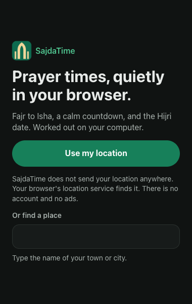
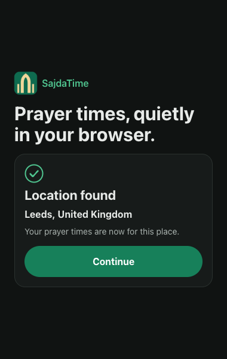
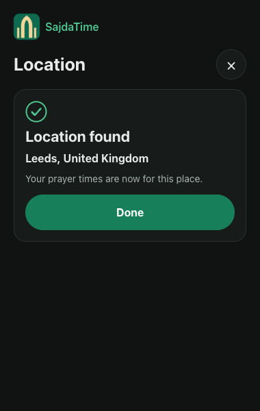

# Review request

**Baseline:** [`aliimrankhan86/sajdatime-extension`](https://github.com/aliimrankhan86/sajdatime-extension) at commit `4082931` on `main`, plus this Step 4 commit on top of it, which is the one to review. `4082931` is the accepted Step 3b (Ramadan notice, Eid notice, iftar wording). Step 4 of [`docs/UX-PLAN.md`](UX-PLAN.md) is the design foundation: U1, U2, U3, U12 and every test in §5.

**Previous reviews:** Step 1 (`ca39f1a`) READY with three P2 fixes; Step 2 (`cf60111`) NOT READY for a missing notification icon, a Play button that did not return and a cleared self-clear alarm, all repaired in `fd002ba` and judged READY; a P3 fix in `a534306`; Step 3a (`432223b`) READY with its P2 fix in `7debc97`; Step 3b (`4082931`) READY. The security foundation is `docs/SECURITY.md`, enforced by code. All of that is history for this review.

**Date:** 28 October 2026.
**Reviewer:** Claude, Opus review pass.
**Owner:** Ali. He presses Submit, Publish, Merge, payment and consent. Do not ask him for credentials.

## What this is

A Manifest V3 browser extension, Chrome first and Edge later. It shows today's six prayer times for a saved place, the next prayer with a countdown, the Hijri date, a small Settings screen, optional prayer alerts, Ramadan labels for Suhoor and Iftar, a coming-Ramadan notice, an Eid notice, an iftar alert, and now a System, Light or Dark theme. It is a separate product from the Android app. Do not review it as a port of `SajdaTime`.

There is no account, no ad, no analytics, no host permission, no content script and no runtime network request. Location is handled on the computer. Binding decisions are in [`docs/DECISIONS.md`](DECISIONS.md); if the plan and a decision disagree, the decision wins. The current state is [`docs/HANDOVER.md`](HANDOVER.md).

## What this commit changed

This is Step 4 of [`docs/UX-PLAN.md`](UX-PLAN.md). It changes no layout, no copy flow and no behaviour other than the theme.

- **U1, tokens named by Material role.** `src/popup/tokens.css` now holds the 32 roles the phone's `docs/design-system/tokens/color.json` defines, with that file's exact light and dark values: `primary` through `inverse-primary`, not the old made-up names. `--cta` and `--on-cta` come from `brand.cta` and `brand.onCta`; `--hero-gradient-start`, `--hero-gradient-middle`, `--hero-gradient-end`, `--on-hero`, `--on-hero-label` and `--on-hero-secondary` come from `gradients.hero`. `tests/fixtures/color.json` is a byte copy of the phone file, and `tests/unit/tokens.test.ts` fails if any token drifts from it, if the two theme blocks lose a name, if `color-scheme` is missing, or if `!important` or `text-transform` appears in the file.
- **U2, the decorative header gradient is gone.** `--hero-a`, `--hero-b` and `--hero-c` and the gradient on `.hero` are removed; the header is a flat `--background`. The hero *card* gradient is kept as tokens, because UX-PLAN 3.1 allows one fixed gradient on that card, and Step 5 builds it. Nothing in this commit paints it.
- **U3, no uppercase brand.** The word mark is "SajdaTime", sentence case, 16 px semibold, `--primary`. `text-transform` is now rejected by the bundle check, so no stylesheet can reintroduce uppercase.
- **U12, System, Light and Dark.** `Theme = 'system' | 'light' | 'dark'`, `System` is the default in `firstSettings`, `migrateSettings` adds `system` to an old setting, and `isSettings` rejects any other value. The choice is stored in `sajdatime.settings.v1` and written as `data-theme` on `<html>`; `tokens.css` sets `color-scheme` per theme. `src/popup/theme.ts` resolves System through `matchMedia` and watches for an operating-system change. `main.tsx` applies the theme synchronously, then applies the stored choice before `render()`. The Settings sheet gains a Theme group with three segments, `aria-pressed` and no invented hint text.
- **The build and the tests enforce it.** `tools/check-bundle.mjs` now rejects a literal colour outside `tokens.css`, `text-transform` and `!important` anywhere in `src/`. `tests/unit/contrast.test.ts` checks every text and background pair in both themes, every UI pair at 3:1, and every hero ink on every hero stop at 4.5:1. `tests/e2e/theme.test.ts` checks the three choices, the migration, the stored write and that the first content appears with the stored theme. `tests/e2e/words.test.ts` scans what is rendered on every screen in both themes, with a self-test proving the detector fires. `tests/e2e/design-foundation.test.ts` measures the computed colours, the block order and the gaps in both themes, because the reviewer cannot be shown a live popup.

## What to run

Node 24 and npm 11 were used. Chrome for Testing is installed by Playwright.

```bash
npm ci
npm run check        # typecheck, 250 unit tests, build, bundle scan
npm run test:e2e     # 68 Playwright tests
SAJDATIME_SCREENSHOTS=1 npm run test:e2e   # refresh docs/images
```

Results on this commit: `npm run check` passed with 250 unit tests in 14 files and `check-bundle: 7 bundle files and the source are clean`; `npm run test:e2e` passed 68 of 68. The screenshots in `docs/images/` were refreshed by the third command.

## Evidence, measured rather than looked at

| Test | What it proves |
| --- | --- |
| `tests/unit/tokens.test.ts` | 37 tests: all 32 roles, both themes, equal to the fixture; brand, CTA and hero values resolve; both blocks hold the same names; `color-scheme` present; no `!important`, no `text-transform` |
| `tests/unit/contrast.test.ts` | 74 tests: 22 text pairs at 4.5:1, 6 UI pairs at 3:1, and 18 hero ink/stop pairs at 4.5:1, in both themes |
| `tests/unit/settings.test.ts` | The theme migration keeps an explicit choice; `firstSettings` is System; an unknown theme is rejected |
| `tests/e2e/theme.test.ts` | System follows the operating system without a reload; Light and Dark beat the opposite operating system; the first content appears with the stored theme (MutationObserver); the selector writes `theme` to storage; an old setting becomes System |
| `tests/e2e/design-foundation.test.ts` | In both themes: body, brand, place, Hijri, card, list, next row, pill and footer colours equal the exact token values; light card has a shadow, dark card has none and a `#2a312e` hairline; the card is above the list and the list above the footer; the gaps are 8 px; Times fits 600 px; nothing crosses the 380 px edge |
| `tests/e2e/words.test.ts` | No em dash, en dash, semicolon, spaced hyphen or section 6.3 banned word on first run, location found, Times, Settings, the Location sheet or a notice, in both themes; the detector fires on a bad sample |
| `tests/e2e/a11y.test.ts` | axe clean on Times, Settings, Location, first run and location found, light and dark; dark is now painted with `data-theme` instead of `emulateMedia` |
| `tests/e2e/design.test.ts` | 44 px targets on Times and Settings in dark, flat dark card, 200 percent zoom, no sideways scroll |

Verified ratios include: light `onSurface/background` 15.05, `onSurfaceVariant/background` 5.92, `onCta/cta` 8.21; dark `onSurface/background` 15.42, `onSurfaceVariant/background` 8.60, `onCta/cta` 4.92. All hero ink/stop pairs pass 4.5:1.

## Screenshots

Review evidence at 380 by 600, not the final store set. They are rewritten only when `SAJDATIME_SCREENSHOTS=1` is set.









The notices show only on the three days before Ramadan and on the two Eids, so no notice screenshot is in this set; the e2e tests assert the notice text and layout instead. The 200 percent Settings screenshot is deliberately tall: judge it as a zoom case, not as the normal layout.

## Known gaps, do not report as new

- **Step 4 intentionally changes no layout.** The Times header is still the scaffold version, the next card is still the compact 28 px card accepted earlier, and the footer is still one line. Step 5 re-plans Times; Step 6 re-plans Settings.
- **Only `.next-card` gets the section 1.2 split** (light shadow and no border, dark hairline and no shadow). The other card-like surfaces keep their hairline in both themes until Step 5 or 6 unify them.
- **The hero tokens are defined but unused.** Nothing paints the hero card until Step 5.
- **A notice still pushes the popup past 600 px** and it scrolls; this is D-030 and Step 5.
- **The notices are the functional form**, not the full `Notice` component (round mark and solid buttons), which is Step 5 or 6.
- **The Theme selector has no hint line.** The brief gives no words for one, and inventing user-facing words is not allowed.
- **An explicit Light or Dark choice on the opposite operating system** can show the operating system's window background for the few milliseconds the storage read takes. The CSP forbids an inline script and `localStorage` is banned, so there is no synchronous cache. Content never paints in the wrong theme, and `theme.test.ts` proves the first content appears with the stored theme; System is exact from the first frame.
- **The word check is an e2e scan of rendered text**, not the literal "unit test" wording of UX-PLAN 5.4, because a raw source scan counts code semicolons and class names as prose and misses runtime strings. The reason and the self-test are recorded in D-031.
- The full first run is not built; the school, madhab, language and six-step sequence are later milestones. English only, no right-to-left layout yet.
- City search matches Latin names only; a located place is named by the nearest city; after midnight the Isha row still shows tonight's time with a "Now" pill; the polar note does not name the latitude it borrowed; the default method survives a searched-town change if the user never chose one.
- No Edge run, no Windows run and no real screen reader run. Zoom is tested at 200 percent only. No GitHub Actions workflow (`gh` lacks the `workflow` scope), so the local checks are the evidence.
- The real geolocation bubble is mocked in the tests because the extension origin cannot be granted a permission from Playwright. The store listing, privacy URL and zip are not final.

## Verdict wanted

Give a verdict in this shape:

- **P0** permanent breakage or a privacy or permission breach.
- **P1** silent wrong result, unusable state, or religious or location content that misleads.
- **P2** quality, maintainability, test gap or design polish.

For each finding: file and line, what happens, how you reproduced it, what the user sees, and the smallest fix. If a finding is based only on reading, say so. If you reran a test, paste the command and result. Do not call the work done because the suite is green. The point of this pass is to find what the green suite missed.

State clearly whether the Step 4 requirements are met, whether the layout is unchanged, and whether this commit is ready for Ali to look at. If another review round is needed, say what the next smallest set of changes is.
