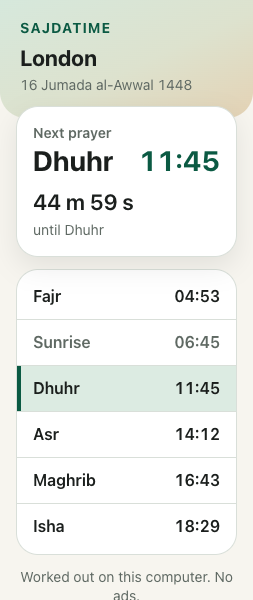
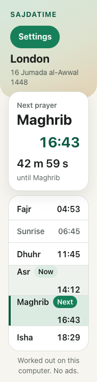
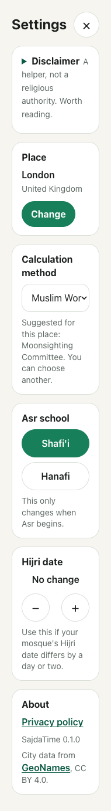

# Review request

**Baseline:** [`aliimrankhan86/sajdatime-extension`](https://github.com/aliimrankhan86/sajdatime-extension) at commit `cb92544` on `main`.
**Previous reviews:** `fab4abb`, code at `c3f39e5`; then `eeac1ad`, which fixed the three P1s from the first pass. This commit does the P2s from the `eeac1ad` pass and records the one new P1 that needs Ali's decision.
**Date:** 27 October 2026.
**Reviewer:** Claude, Opus review pass.
**Owner:** Ali. He presses Submit, Publish, Merge, payment and consent. Do not ask him for credentials.

## What this is

A Manifest V3 browser extension, Chrome first and Edge later. It shows today's six prayer times for a saved place, the next prayer with a countdown, the Hijri date, and a small Settings screen. It is a separate product from the Android app. Do not review it as a port of `SajdaTime` and do not copy phone release notes or store copy into it.

There is no account, no ad, no analytics, no host permission, no content script and no runtime network request. Location is handled on the computer. The full intent is in [`docs/PLAN.md`](PLAN.md). Binding decisions are in [`docs/DECISIONS.md`](DECISIONS.md). If the plan and a decision disagree, the decision wins. The current state is [`docs/HANDOVER.md`](HANDOVER.md).

## What this fix commit changed

The previous pass found that Shia (Jafari and Tehran) days above about 60 degrees north were silently wrong in summer. This commit fixes that and the other P1s.

- **Shia Maghrib.** The main calculation no longer carries adhan's `maghribAngle`. It stays at sunset, so `isUsable` judges the true solar day. Jafari (4 degrees) and Tehran (4.5 degrees) Maghrib now come from a separate Isha-only pass with the Twilight Angle rule, at the same latitude as the day, including the borrowed polar latitude. This mirrors the phone's `PrayerEngine`.
- **Regression evidence.** The new unit tests pin Oslo and Trondheim on 21 June 2026 to values taken from the phone's Java adhan probe: Oslo sunrise 03:54, Jafari Maghrib 23:05, Tehran 23:07; Trondheim Jafari 23:52, Tehran 23:53. Both days are real, not polar.
- **First-run wording.** It no longer says the location is "kept" on the computer. It now says SajdaTime does not send the location anywhere and the browser's location service finds it.
- **Docs.** `DECISIONS.md` D-002 and `HANDOVER.md` now state the separate Shia pass instead of claiming every method mirrors the phone in the same way. The stale "pick this up in /tmp" instructions are gone.
- **Settings focus.** Controls no longer use native `disabled` while saving. They use `aria-disabled` plus a save guard, so focus stays on the pressed control after a save. A new test presses Enter on Hanafi and on the Hijri stepper and asserts focus.
- **Smaller P2s.** The Next row no longer carries `aria-current`; row text has spaces so a screen reader does not hear "AsrNow14:12"; a long place name wraps; city search says "Top 6 places" only when a seventh match exists; the Vite module preload polyfill is off so the bundle has no injected `fetch` helper.
- **Second-pass P2s.** The keyboard focus test now waits for the heading before pressing, so it no longer races Preact's focus effect. Times are truncated to the whole minute after corrections and the order clamp, matching the phone. At 200 percent zoom the Hijri minus and plus stack instead of sitting side by side. `CLAUDE.md` no longer lists permissions the manifest does not use, the plan points at D-002 instead of the superseded `maghribAngle` build, and the Java probe that produced the Oslo and Trondheim values is committed under `tools/adhan-probe`.

## Open P1 from the second review

The second review found that the Shia Maghrib pass caps its result at sunset plus `angle / 60` of the night, even on a summer day when the sun does reach 4 or 4.5 degrees. The phone has the same cap. Above about 52 degrees north this makes the shown Maghrib early: Oslo on 21 June shows 23:05, when the sun is about 2.26 degrees down, rather than the true 4 degree moment near 23:36. This is recorded in D-002 and HANDOVER. It is not changed here because it is religious content and must stay in step with the phone. **Ali has to choose:** use the true angle whenever the sun reaches it, or keep the cap and describe it plainly. Do not treat the current time as confirmed correct for the UK and Scandinavia until he does.

## What to run

Node 24 and npm 11 were used. Chrome for Testing is needed because branded Chrome refuses an unpacked extension in this setup.

```bash
git clone https://github.com/aliimrankhan86/sajdatime-extension.git
cd sajdatime-extension
npm ci
npm run check
npm run test:e2e
```

`npm run check` runs strict TypeScript, Vitest and a production build. `npm run test:e2e` builds `dist` and drives the loaded extension with Playwright. It finds Chrome for Testing through `SAJATIME_CHROME` or Playwright's cache. If neither exists, set `SAJATIME_CHROME` to a Chrome for Testing binary.

To look by hand, open `chrome://extensions`, enable Developer mode, choose **Load unpacked** and pick `dist/`. The popup is 380 by 600. Settings is the green button in the header.

## What to judge

1. **The Shia fix in the code.** Read `src/core/engine.ts` and `src/core/methods.ts` against the phone's `PrayerEngine.kt`. Check that the main day check sees sunset, that the second pass uses the same latitude, that the 4 and 4.5 degree values are right, and that nothing else uses the removed `maghribAngle`. Look for a remaining path where a Shia day is projected or falls back to sunset.
2. **Design against the brief.** Quiet Glass tokens, 380 by 600 popup, spacing, type hierarchy, the solid green action button with bold white text, no two icon buttons side by side, a close control on every dismissable screen, times in tabular numerals, nothing below 14 pixels, targets at least 44 pixels. The plan's section 3 and section 6 are the written brief.
3. **The Times screen in every state.** First open, next prayer today, next prayer tomorrow after Isha, a current prayer that is not the next one, sunrise as a quieter row, a polar estimate, a very long place name, 12-hour and 24-hour browser languages, 150 and 200 percent zoom, light and dark.
4. **First run and Settings.** Whether the words are plain and true, whether the location flow is understandable without a manual, whether Settings preserves a deliberately chosen method when the place changes, and whether the disclaimer is intact and readable. The disclaimer must never be removed, softened or hidden.
5. **Accessibility.** axe is not a screen reader. Check the tab order, the heading focus, Escape, the `aria-current` value, the live city hint and whether the visible pills match what is announced. Check the new `aria-disabled` controls still behave for keyboard and pointer, and that focus does not move during a save.
6. **Correctness and privacy in the code.** The engine mirrors the phone's high-latitude rule, the projection to the signed reference latitude, the Ramadan Isha adjustment, manual corrections last and the ascending clamp. The manifest should still ask only for `storage` and `geolocation`. There should be no `fetch` to a remote host, no remote code and no content script.
7. **Test quality.** Look for tests that only assert the code's own output, tests that pass for the wrong reason, and state that is not covered. The engine fixtures are the phone's values, not Aladhan's, except the broad sanity fixtures. The new Oslo and Trondheim values were produced with the phone's Java adhan library, not by running the extension.
8. **Documentation accuracy.** If a claim in `HANDOVER.md` is not true of this commit, that is a finding.

## Evidence in this commit

`npm run check`: 7 unit files, 83 tests passed, strict typecheck passed, production build passed.
`npm run test:e2e`: 25 tests passed.

| Test file | What it covers |
| --- | --- |
| `tests/unit/engine.test.ts` | Phone fixtures, including the new Oslo and Trondheim Shia summer cases, polar projection and correction clamp |
| `tests/unit/aladhan.test.ts` | 13 broad independent sanity fixtures |
| `tests/e2e/popup.test.ts` | Times, 253 pixel viewport, countdown tick, 12-hour language, tomorrow Fajr, first run wording, Makkah fallback, Settings, city search, method persistence |
| `tests/e2e/audit.test.ts` | Asr school, method change, place change, dark link contrast, keyboard focus and Escape, focus after a save |
| `tests/e2e/design.test.ts` | Now and Next pills, Next row has no `aria-current`, 44 pixel controls, 190 pixel reflow, dark flat card, no network request |
| `tests/e2e/a11y.test.ts` | axe 4.14, WCAG 2.2 AA tags, Times, Settings, Location and first run, light and dark |
| `tests/unit/contrast.test.ts` | 14 token pairs, including the hero gradient stops and the focus ring |

## Screenshots

These are review evidence at 380 by 600, not the final store set.






The 190 pixel Settings screenshot is deliberately tall. It shows the stacked school and Hijri controls, and the native select truncating the longest method name. Judge whether that is acceptable at that zoom, not as the normal layout.

## Known gaps, do not report as new

- The Times header is the scaffold version: a word mark and a Settings pill, not the plan's 32 pixel logo, Gregorian date over the Hijri date, and town chip with pin and refresh. The footer is one line, not the two solid buttons. The next card has no glyph and no five prayer bars.
- The next card uses a 28 pixel name and time with a 22 pixel countdown. The plan's type table says a 46 pixel countdown. The previous review accepted the compact card; Ali also accepted it. Do not reopen it unless it causes a real usability fault.
- The full first run is not built. There is one location step and a city search. The school, madhab, language and six-step sequence are later milestones. The first-run pick always starts Sunni and suggests a method from the country.
- No alarms, badge, notifications, offscreen audio, Ramadan notices, suhoor, Eid, PDF timetable, Qibla or full About page.
- English only. No language switcher and no right-to-left layout yet. A remaining recorded P2: an Arabic browser shows Arabic meridian words beside the English labels. The digits are not yet forced to Latin.
- City search matches Latin names only.
- A remaining recorded P2: after midnight the Isha row still shows tonight's time with a "Now" pill.
- A remaining recorded P2: the default method survives a place change if the user never chose one.
- A remaining recorded P2: the polar note does not name the latitude it borrowed.
- **Open P1, inherited from the phone:** the Shia Maghrib cap above about 52 degrees north in summer, described above. This is waiting on Ali, not on code.
- No Edge run, no Windows run and no real screen reader run. These are stated limits.
- No GitHub Actions workflow. This Mac's `gh` login lacks the `workflow` scope. Local checks are the evidence.
- The real browser geolocation bubble is mocked in the tests because the extension origin cannot be granted a permission from Playwright.
- The store listing, privacy URL and zip are not final.
- The service worker is nearly empty by design. Its presence is not evidence that alarms work.

## Verdict wanted

Give a verdict in this shape:

- **P0** permanent breakage or a privacy or permission breach.
- **P1** silent wrong result, unusable state, or religious or location content that misleads.
- **P2** quality, maintainability, test gap or design polish.

For each finding: file and line, what happens, how you reproduced it, what the user sees, and the smallest fix. If a finding is based only on reading, say so. If you reran a test, paste the command and result. Do not call the work done because the suite is green. The point of this pass is to find what the green suite missed.

State clearly whether the previous P1s are actually fixed, and whether this commit is ready for Ali to look at. If another review round is needed, say what the next smallest set of changes is.
